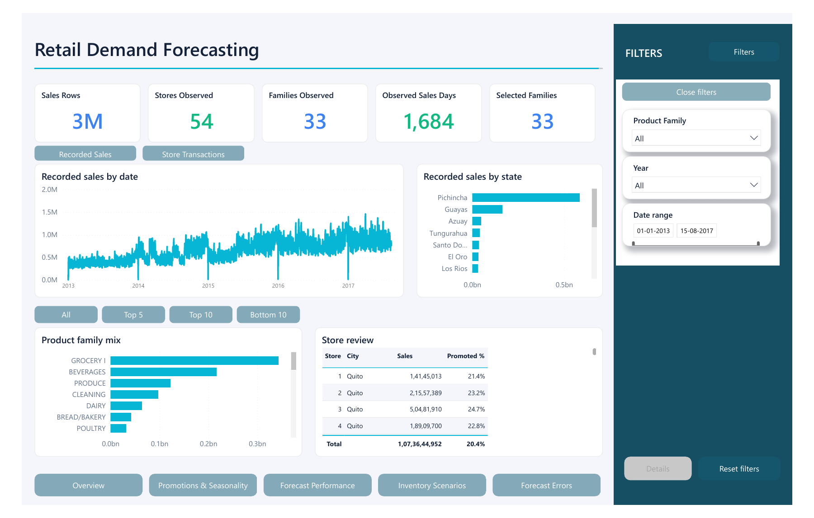
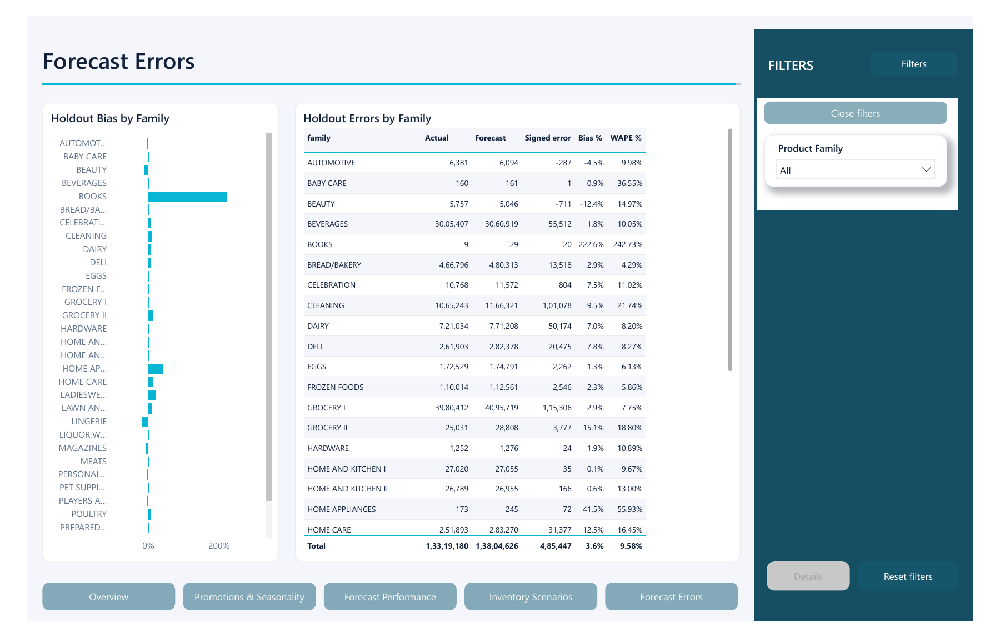

# Retail Demand Forecasting

This case study compares forecasts of recorded grocery sales on future time blocks, then uses the forecasts in an illustrative inventory scenario. The source contains **3,000,888 sales rows**, **54 stores**, **33 product families** and **1,684 observed dates** from January 2013 to August 2017.



## Verified forecast results

| Measure | Result |
|---|---:|
| Selected model | Random Forest |
| Final holdout | 31 July–15 August 2017 |
| Pooled WAPE | 9.58% |
| Macro-family WAPE | 22.12% |
| MAE per national family-day | 2,415.82 |
| Seasonal-naive pooled WAPE | 12.82% |
| Relative pooled WAPE reduction versus seasonal naive | 25.28% |
| Forward forecasts, 16–31 August 2017 | 528 family-day predictions |

The model winner was frozen using two earlier 16-day folds, scored by mean macro-family WAPE. Final holdout results did not select or tune the winner. Four candidates were evaluated: weekly seasonal naive, 28-day moving average, Random Forest and XGBoost. No competition leaderboard submission or production accuracy is claimed.

The pooled improvement is larger than the macro-family improvement. Small categories remain difficult: BOOKS has 242.73% holdout WAPE, and SCHOOL AND OFFICE SUPPLIES has 72.69%. XGBoost has much worse macro-family WAPE despite a competitive pooled score. These differences are preserved in the exports rather than hiding low-volume errors.

## Business questions and deliverables

- Where do recorded sales concentrate across families, stores, states, weekdays and months?
- Which promotion patterns merit investigation, without claiming causal uplift?
- Does a recursive model beat simple baselines on a future block?
- How does an assumed safety factor change service and stock in a transparent scenario?

The project includes 21 MySQL business queries, Python cleaning and validation, an executed notebook, an offline interactive HTML dashboard, five Power BI pages and 26 DAX measures. Open `reports/Interactive_Dashboard.html` for the browser report or `powerbi/Retail_Demand_Inventory.pbip` for editable Power BI source. Native refresh status is recorded in `reports/QA_STATUS.md`.

## Reproduce

Use Python 3.12 and the versions in `requirements-tested.txt`.

```text
pip install -r requirements.txt
python src/pipeline.py --source-dir PATH_TO_FAVORITA_FILES
python src/reporting.py
python src/comparison_analysis.py
python -m pytest tests -q
```

Required source files: `train.csv`, `stores.csv`, `transactions.csv`, `holidays_events.csv`. Add `test.csv` to generate the 16-day forward forecast used in this report. Download from the [original Kaggle source](https://www.kaggle.com/competitions/store-sales-time-series-forecasting/data); exact file hashes and the public data archive used for this build are in `reports/DATA_PROVENANCE.json`. Keep source files local. The archive's holiday file exactly matches the file supplied by the user.

For MySQL, create an empty dedicated database, set `DATABASE_URL` using `.env.example`, then run `python src/database.py`. It creates dimensions before facts, rejects populated target tables and load warnings, and exports each query result. No credentials are embedded or committed.

For Power BI, set `DataRoot` to your local `demand/data/` folder with a trailing slash, then Refresh. Full row data and cached PBIX files are intentionally excluded from the public source package.

## Decisions that affect interpretation

**Missing dates.** The source omits 25 December in 2013, 2014, 2015 and 2016. All observed data is retained for descriptive analysis. Modeling uses the complete 233-day tail from 26 December 2016, so lags refer to actual calendar days. Missing dates are not assumed to be zero demand or verified store closures. This model window supports short-term weekly patterns, not a reliable annual seasonal estimate.

**Forecast scope.** Targets are national daily recorded sales per family, not store-level or item-level demand. Promotion counts are assumed known in the forecast horizon. Holiday exposure counts each affected store once and honors locale and transferred-holiday rules. The store list is used as a fixed exposure universe; opening dates and stock availability are unobserved. Oil is deliberately excluded. Forecasts use recursively predicted history, never future actual target values.

**Quantity and metrics.** Family sales may represent item counts or fractional quantities. Their combined total is a recorded-quantity reporting control, not revenue or interchangeable physical units. Pooled WAPE therefore emphasizes high-quantity families. Macro-family WAPE is also reported, and zero-denominator families yield no WAPE. Sales are not unconstrained demand because stockout availability is unknown.

**Inventory scenario.** Seven-day lead and review periods, three safety factors (0, 1.28, 1.65), forecast-based initial stock and 0.01 assumed holding-cost unit per stock unit-day are scenario inputs. The simulation uses a short 16-day holdout and lost sales; it is not an operational inventory recommendation. Stock and cost comparisons combine family-specific quantities and have no monetary interpretation. No realized savings, deployment or causal business impact is claimed.

## Review the evidence

- `reports/BUSINESS_FINDINGS.md`: conclusions, limitations and follow-up decisions.
- `data/exports/forecast_metrics.csv` and `family_forecast_metrics.csv`: all model results.
- `data/exports/fold_dates.csv`: exact training and evaluation boundaries.
- `data/exports/inventory_scenarios.csv`: assumed service–stock scenarios.
- `reports/mysql_validation.json`: independent reconciliation.
- `powerbi/MEASURE_DEFINITIONS.md`: DAX scope and denominators.
- `notebooks/01_analysis.ipynb`: executed review of generated results.

## Comparison view



[Open the comparison dashboard](reports/Comparison_Dashboard.html) after downloading the repository; these comparison charts require an internet connection for Plotly.

Forecast error review adds a focused review page with two contextual measures, a comparison table, chart tooltips and a project-specific theme. Final holdout: 31 Jul-15 Aug 2017; selected model only. Positive bias means overforecasting. Percentages use recorded quantities; no future actuals enter training. SQL Q21 provides the related aggregate analysis. See [enhancement checks](reports/COMPARISON_VALIDATION.md).

Current report: **5 pages, 26 DAX measures and 21 SQL analyses**.

[Report notes](powerbi/REPORT_NOTES.md) contain the date, scope and interpretation details behind the visuals.

## Dashboard layout

Filters occupy a dedicated right column. Analysis pages are reached from the bottom navigation, while view controls stay beside their charts.

## Dashboard controls

The redesigned report adds page navigation, collapsible synchronized filters, metric and ranking views, a contextual tooltip page and a drillthrough detail page. Light and dark themes are included. Display bookmarks preserve filter selections; existing SQL, DAX and imported data are retained. See the [control guide](docs/dashboard-controls.md) and [Power BI source](powerbi/Retail_Demand_Inventory.Report).
